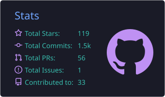
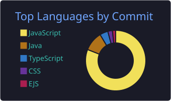
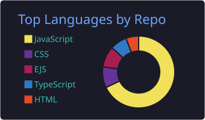
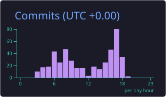

<h3>A passionate Developer building things for the web</h3>

 

- 🌱 Currently learning **ML/AI, Advanced DSA and System Design**
- 💼 Full Stack Developer Intern @ **FoodNESTs Technologies**
- 💬 Ask me about **HTML, CSS, JavaScript, TypeScript, React, Next.js, Node.js, Express.js, Java, MongoDB, MySQL, PostgreSQL, DSA, Competitive Programming**
- 📫 Reach me at **[ssmishra9918@gmail.com](mailto:ssmishra9918@gmail.com)** or **[mishrasaty989@gmail.com](mailto:mishrasaty989@gmail.com)**

---

### 📊 GitHub Stats

  
  

  
  

---

### 🌐 Connect with me

  
  
  
  
  
  

---

### ⚒️ Languages and Tools

  
  
  
  
  
  
  
  
  
  
  
  
  
  
  
  

---

  

